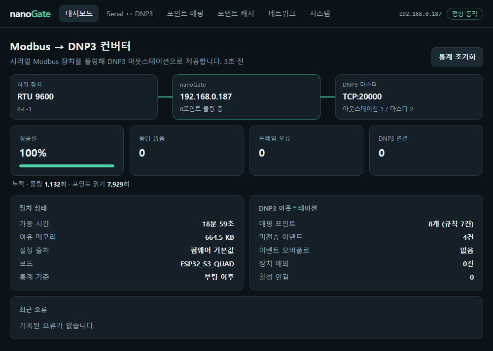
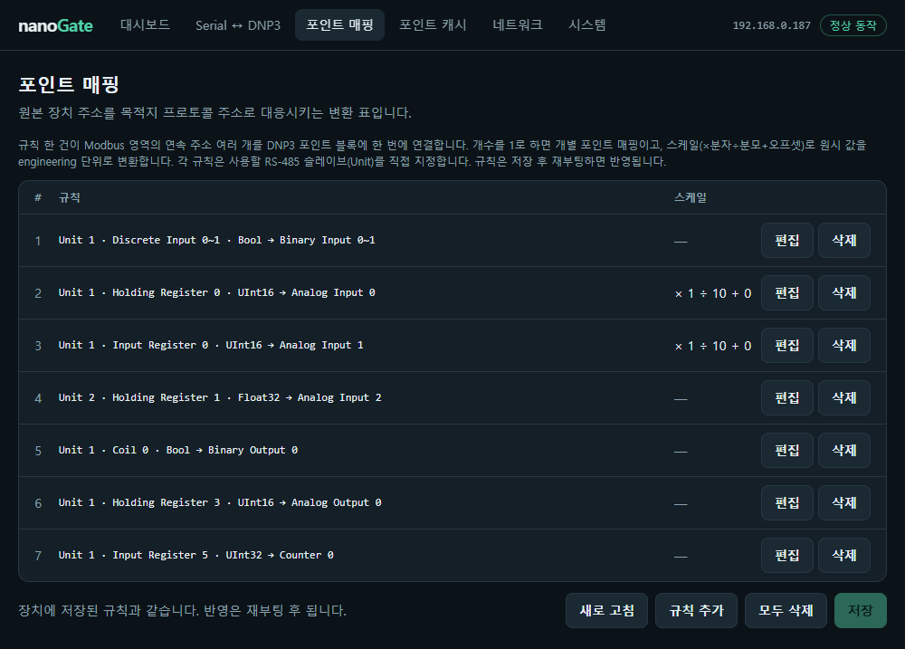
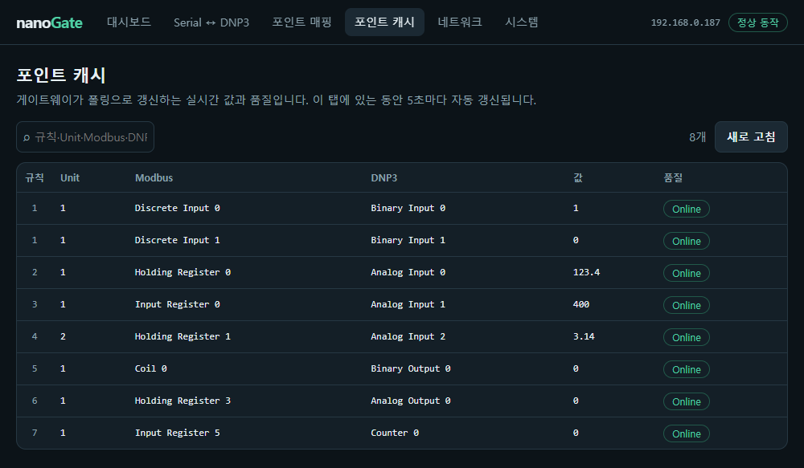
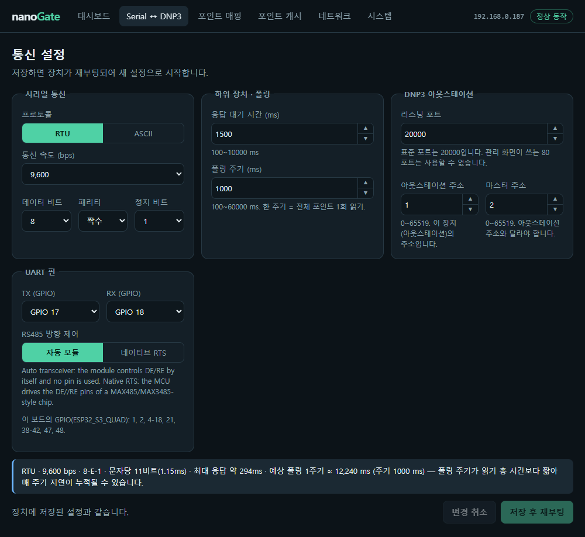
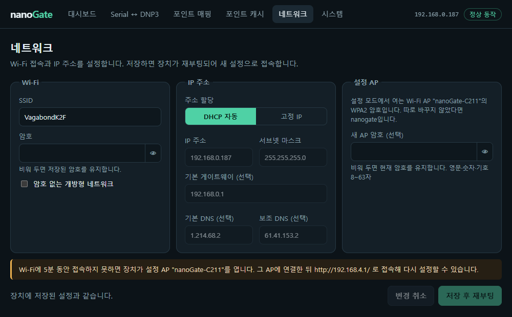
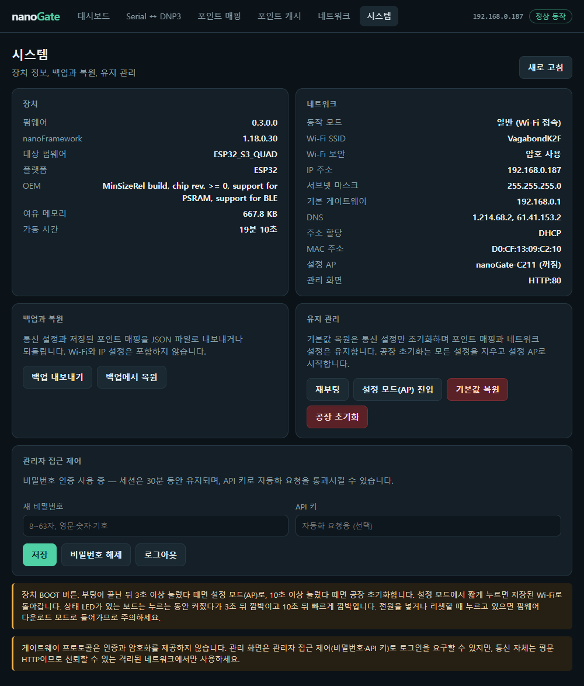

# nanoGate

**.NET nanoFramework** 기반의 초소형 프로토콜 컨버터 게이트웨이 펌웨어입니다.
Modbus 시리얼(RS-485) 장치를 IP 네트워크 프로토콜(Modbus TCP · MQTT · DNP3)로 연결하며, 모든 펌웨어가 브라우저 관리 화면을 기본으로 내장합니다.

PC나 Linux 게이트웨이 없이 ESP32 보드 하나만으로 현장을 연결하는 것이 목표입니다.
프로토콜 엔진은 [VagabondK.nF](https://www.nuget.org/packages?q=VagabondK.nF) NuGet 패키지를 사용하므로, 각 게이트웨이에 필요한 런타임만 선택해 빌드할 수 있습니다.

## 주요 기능

- **웹 관리 화면** — 대시보드·통신 설정·포인트 매핑·포인트 캐시(MQTT·DNP3)·네트워크·시스템 탭. 데스크톱과 모바일 폭 모두 지원
- **관리 인증** — 비밀번호 해시 저장, 로그인 잠금, API 키와 리프레시 토큰, CSRF/Origin 검사, CSP 헤더
- **포인트 매핑** — 논리 포인트 최대 32개, 주소 공간·스케일·접근 모드 편집, 프로필별 파일 격리
- **RS-485 방향 제어** — 자동 제어 트랜시버(기본) 또는 MAX3485류 수동 트랜시버용 네이티브 RTS(DE/RE) 핀 제어
- **설정 모드** — Wi-Fi 정보가 없으면 장치 자체 AP(`nanoGate-XXXX`)를 열어 브라우저에서 네트워크를 설정합니다. BOOT 버튼으로도 진입할 수 있습니다
- **백업·복원** — 통신 설정과 포인트를 JSON 한 파일로 내보내고 가져옵니다. 자격 증명은 백업에 포함되지 않습니다

## 게이트웨이

| 프로젝트 | 변환 경로 | 기본 포트 | 프로토콜 패키지 |
|---|---|---|---|
| `nanoGate.ModbusSerialToTcp` | Modbus RTU/ASCII ↔ Modbus TCP (PDU 중계) | TCP 502 | `VagabondK.nF.Modbus.*` |
| `nanoGate.ModbusToMqtt` | 시리얼 Modbus 폴링 → MQTT 게시, RW 포인트 명령 구독 | 브로커 1883 | `VagabondK.nF.MQTT` |
| `nanoGate.ModbusToDnp3` | 시리얼 Modbus → DNP3 Outstation (TCP) | DNP3 20000 | `VagabondK.nF.DNP3.*` |

`nanoGate.ModbusSerialToTcp`는 요청 PDU를 해석하거나 캐시하지 않고 시리얼 버스에 그대로 전달하는 중계 방식이며, 하위 장치의 모든 Unit ID(1~247)를 지원합니다.
`nanoGate.ModbusToMqtt`는 `nanogate/<포인트 ID>` 토픽으로 JSON(또는 템플릿·binary·plain) 페이로드를 게시하고, RW 포인트에는 `<토픽>/set` 명령을 구독합니다. 접속 상태는 retain 메시지와 Last Will로 안내합니다.
`nanoGate.ModbusToDnp3`는 포인트 매핑과 범위 규칙(최대 64개, 기존 자동 매핑 파일은 규칙으로 자동 변환)으로 DNP3 코일·디스크리트·레지스터를 제공하는 Outstation이며, 마스터의 Select/Operate와 Direct Operate 명령을 Modbus 쓰기로 변환합니다.

Sparkplug, BACnet/IP, SNMP 등 다른 조합은 `VagabondK.nF` 패키지 조합으로 추가 가능한 후보로 두고 아직 구현하지 않았습니다.

## 저장소 구조

```
nanoGate.Core     공통 관리 계층: 웹 서버·인증·설정 저장·네트워크·BOOT 버튼·보드 정보
nanoGate.Points   공통 포인트 매핑 엔진과 /api/points 컨트롤러
nanoGate.Modbus*  게이트웨이 3종 (각각 GatewaySettings + Profile + WebUi 조각)
```

### 공통 관리 계층

웹 관리 화면은 모든 펌웨어가 `nanoGate.Core`를 공유합니다. 각 게이트웨이는 `GatewayProfile` 구현(설정 키·검증·통신 루프)과 `dashboard/settings/tabs` 화면 조각만 제공하고, 로그인·네트워크·시스템 화면과 설정 저장, 백업·복원, 포인트 저장은 공통 코드가 담당합니다.
`WebUi\*.nf.html` 조각은 빌드할 때 `VagabondK.nF.WebUi` 패키지의 targets가 합쳐 줄이고(축소) gzip으로 압축한 뒤 32 KB씩 조각내 펌웨어의 바이너리 자원으로 저장합니다. 동작 중에는 페이지 전체를 메모리에 올리지 않고 요청한 구간만 조각에서 읽어 넘깁니다. 화면 문자열은 `texts.resx`(영어)와 `texts.ko.resx`(한국어)로 관리합니다.

## 관리 화면

아래는 `nanoGate.ModbusToDnp3` 펌웨어를 실제 구동하고 시리얼 Modbus 슬레이브를 폴링한 상태의 관리 화면입니다.

**로그인** — 관리 화면 접속 시 비밀번호 인증. 5회 실패 시 로그인이 잠깁니다


**대시보드** — 폴링 성공률·가동 시간·DNP3 아웃스테이션 상태 요약



**포인트 매핑** — Modbus 연속 주소 → DNP3 블록 범위 규칙과 스케일 편집



**포인트 캐시** — 규칙·Unit·주소별로 해석된 실시간 값과 품질, 5초마다 자동 갱신



**통신 설정** — 시리얼·DNP3·UART 핀과 RS-485 방향 제어



**네트워크** — Wi-Fi·설정 모드·IP 구성



**시스템** — 인증·백업·복원·재부팅·공장 초기화



## 대상 보드

| 보드 | nanoFramework 타깃 | 기본 TX/RX | 선택 가능 GPIO |
|---|---|---|---|
| Geekble Nano (ESP32-S3) | `ESP32_S3_QUAD` | GPIO17 / GPIO18 | 1, 2, 4~18, 21, 38~42, 47, 48 |
| Geekble Mini (ESP32-C3) | `ESP32_C3` 계열 | GPIO6 / GPIO7 | 0, 1, 3~7 |

- UART는 `COM2`를 사용하며 설정한 TX/RX 핀을 `SetPinFunction`으로 배정합니다. RS-485 DE/RE 핀은 기본 GPIO15입니다.
- 보드는 `SystemInfo.TargetName`으로 자동 판별하고, 설정 화면의 핀 선택지와 검증에 같은 표를 사용합니다.
- **WT32-ETH01**(유선 LAN, `ESP32_WT32_ETH01` 타깃)은 펌웨어 지원이 확인된 정식 대상입니다. nanoGate 쪽 Ethernet 초기화 분기는 아직 준비 중이라 현재 코드는 Wi-Fi 전용입니다.
- C3는 스트래핑·플래시·USB·콘솔 핀이 제약되어 있어 위 표 밖의 GPIO는 설정할 수 없습니다.

## 빠른 시작

### 준비물

- Visual Studio 2022 이상과 [.NET nanoFramework Visual Studio 확장](https://marketplace.visualstudio.com/items?itemName=nanoframework.nanoframework-vs2022-extension) (이 문서의 빌드·배포는 Visual Studio 2026에서 검증)
- [nanoff](https://www.nuget.org/packages/nanoff)(`dotnet tool install -g nanoff`)
- ESP32 보드와 USB 케이블, RS-485 트랜시버(MAX3485 등) 또는 자동 방향 모듈

### 1. 보드 펌웨어 설치

```powershell
nanoff --update --target ESP32_S3_QUAD --serialport COM3
```

### 2. 빌드와 배포

```powershell
nuget restore .\nanoGate.sln
msbuild .\nanoGate.ModbusSerialToTcp\nanoGate.ModbusSerialToTcp.nfproj /t:Rebuild /p:Configuration=Release
nanoff --nanodevice --serialport COM3 --deploy --image .\nanoGate.ModbusSerialToTcp\bin\Release\nanoGate.ModbusSerialToTcp.bin --reset
```

`msbuild`는 Visual Studio 개발자 프롬프트에서 실행해야 경로에 잡힙니다. 다른 게이트웨이는 프로젝트 이름만 바꾸면 되고, VS에서 해당 프로젝트를 시작 프로젝트로 지정해 빌드·배포해도 됩니다. NuGet 복원은 nuget.org의 `VagabondK.nF 0.1.0-preview.8`와 nanoFramework 패키지를 사용합니다.

### 3. 처음 접속하기

전원을 넣으면 게이트웨이가 저장된 Wi-Fi로 접속을 시도합니다. 설정이 없거나 실패하면 잠시 뒤 **설정 AP**(`nanoGate-XXXX`, WPA2 암호 `nanogate`)가 열리므로, 노트북이나 휴대폰으로 이 AP에 접속해 `http://192.168.4.1/`을 엽니다.

**Network** 탭에서 대상 Wi-Fi SSID와 암호를 저장하면 장치가 재부팅되어 해당 네트워크로 접속합니다. 이후 표시된 IP로 관리 화면에 들어가면 됩니다.

비밀번호를 설정하기 전까지 관리 화면은 인증 없이 열립니다. **System** 탭(또는 로그인 화면의 암호 설정)에서 관리자 비밀번호를 먼저 정하는 것을 권장합니다.

## 설정 모드(AP)와 BOOT 버튼

- BOOT 버튼을 **3초 이상** 길게 눌렀다 놓으면 설정 모드로 재부팅합니다. 설정 모드에서는 Wi-Fi 접속 시도가 멈추고 설정 AP만 열립니다.
- 설정 모드에서 버튼을 **짧게(80ms 이상)** 누르면 저장된 Wi-Fi로 돌아가고, **10초 이상** 누르면 설정·포인트·네트워크·비밀번호를 모두 지운 뒤 설정 모드로 재부팅합니다(공장 초기화).
- 설정 모드에서는 활동이 10분 동안 없으면 자동으로 일반 모드로 돌아갑니다.

## 관리 API

장치에는 관리 HTTP 서버가 포트 80(고정)에서 동작합니다. 모든 POST는 `x-nanogate: 1` 마커 헤더와 `Host`/`Origin` 검사를 요구하며, 오류는 `{"ok":false,"error":"…"}`(한국어)와 상태 코드로 알려줍니다.

| 메서드 | 경로 | 설명 |
|---|---|---|
| GET | `/api/status` | 상태·설정·통신 통계 JSON (설정 값도 여기서 조회) |
| GET | `/api/system` | 펌웨어·nanoFramework 버전, 보드, 네트워크 정보 |
| POST | `/api/settings` | 통신 설정 저장(모든 키 전달, 저장 후 재부팅) |
| GET/POST | `/api/points` | 포인트 매핑 파일 조회·저장(32 KB 이하 스트리밍 검증) |
| POST | `/api/network` | Wi-Fi·IP·설정 AP 암호 저장(재부팅) |
| GET/POST | `/api/rules` | (DNP3) 포인트↔DNP3 주소 매핑 규칙, `POST /api/rules/reset`으로 초기화 |
| GET | `/api/cache` | (MQTT·DNP3) 포인트 캐시 스냅숏 |
| POST | `/api/auth/login` 외 | 로그인·비밀번호·API 키·리프레시 토큰(`api/auth/*`, VagabondK.nF.Web 제공) |
| POST | `/api/reboot`, `/api/setup-mode`, `/api/factory-reset`, `/api/statistics/reset`, `/api/settings/reset` | 유지보수 동작 |

## 보안

- 관리자 비밀번호는 해시로 `I:\nanogate.auth`에 저장되며 설정 파일과 백업 JSON에는 포함되지 않습니다. 로그인 실패가 반복되면 잠깁니다.
- HTTP 연결에는 TLS가 없고 Modbus TCP·MQTT·DNP3 자체 인증도 채널 보안에는 의존하지 않습니다. **관리 화면과 프로토콜 포트는 신뢰된 격리 네트워크에서만 사용하십시오.**
- 설정 AP의 기본 암호 `nanogate`는 알려져 있으므로 Network 탭에서 바꾸는 것이 좋습니다.

## 성능 참고

ESP32-S3 Quad(`ESP32_S3_QUAD`, 8 MB PSRAM)에 Modbus↔MQTT 펌웨어 0.3.x를 올린 실측 기준:

- 배포 번들 약 359 KB, 유휴 여유 메모리 약 690 KB
- RS-485 9600 bps 폴링에서 포인트 32개 주기 폴링과 MQTT 게시 동시 동작 확인
- ESP32-C3(Geekble Mini)에서는 같은 구성의 여유 메모리가 약 9 KB까지 줄어듭니다. C3는 경량 구성의 기준으로만 사용하고, 기능을 늘릴 여지가 있는 개발에는 S3를 권장합니다

수치는 GC·오류 메시지·실행 상태에 따라 달라집니다.

## 라이선스

[MIT](LICENSE)
